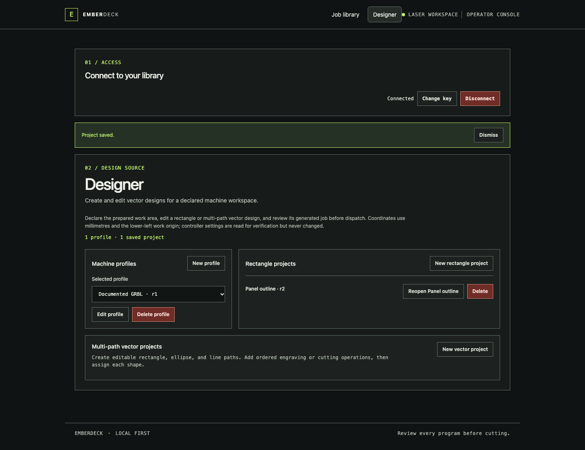

# Overview

**Your laser cutter's command deck.** Self-hosted job management with an embedded
browser console, distributed controller workers, and trusted process plugins.
One Go executable runs on Raspberry Pi, macOS, Linux, and Windows, or in Docker
and LXC. No Node runtime, frontend build, cloud account, or external database.

**Early development: simulator verified, physical hardware not yet qualified.**
GRBL 1.1 is the first protocol. Proprietary DSP controllers (including Ruida) are
not supported. EmberDeck is not a safety controller: supervise cutting and use
hardware interlocks and an emergency stop.

Start with a prebuilt release below, then follow the
[illustrated Operator Guide](docs/operator-guide.md) to use the console. For
service setup, see [Deployment](docs/deployment.md). Review
[Troubleshooting](docs/troubleshooting.md), the [Glossary](docs/glossary.md), and
[Safety & Limitations](docs/safety.md) before connecting a machine.

## Download a release

Choose your operating system and architecture from the
[GitHub Releases](https://github.com/ConstructorFleet/emberdeck/releases) page.
The release also includes a multi-architecture Linux image at
`ghcr.io/constructorfleet/emberdeck:vX.Y.Z` (amd64, arm64, and arm/v7); the
`:latest` tag points to the latest published release.

| Platform | Release asset |
| --- | --- |
| macOS Intel (amd64) | `emberdeck-darwin-amd64` |
| macOS Apple silicon (arm64) | `emberdeck-darwin-arm64` |
| Linux x86-64 (amd64) | `emberdeck-linux-amd64` |
| Linux 32-bit ARM, ARMv7 (arm) | `emberdeck-linux-arm` |
| Linux 64-bit ARM (arm64) | `emberdeck-linux-arm64` |
| Windows x86-64 (amd64) | `emberdeck-windows-amd64.exe` |
| Checksums | `SHA256SUMS` |
| Linux container (amd64, arm64, arm/v7) | `ghcr.io/constructorfleet/emberdeck:vX.Y.Z` |

Download all six binary assets and `SHA256SUMS` into the same directory, then
verify the files on Linux with `sha256sum -c SHA256SUMS`. macOS includes the
equivalent `shasum -a 256 -c SHA256SUMS`; on Windows, use Git Bash or WSL with
`sha256sum`. For example, after downloading the Linux amd64 binary:

```sh
sha256sum -c SHA256SUMS
chmod +x emberdeck-linux-amd64
./emberdeck-linux-amd64 -version
```

On macOS, use the asset matching the Mac. If Gatekeeper blocks the binary after
checksum verification, remove its quarantine attribute, for example:

```sh
xattr -d com.apple.quarantine ./emberdeck-darwin-arm64
chmod +x ./emberdeck-darwin-arm64
./emberdeck-darwin-arm64 -version
```

The command `-version` prints the release version. To run a software-only local
demo on Linux or macOS, generate and display an API key in your terminal, keep it
private, and start the server with the matching binary:

```sh
export EMBERDECK_API_KEY="$(openssl rand -hex 32)"
printf 'API key (keep private): %s\n' "$EMBERDECK_API_KEY"
./emberdeck-linux-amd64 serve -simulate -data ./data
```

Replace the binary name with the asset you downloaded. On first start, the
server migrates the key into its initial `bootstrap-admin` credential. After initial
access, rotate to named credentials; see the
[HTTP API and worker contract](docs/api.md) for the credential contract. Open
`http://127.0.0.1:8080` (type this address in your browser) and enter the
displayed key. `-simulate` runs software only and sends no commands to a cutter.
For Windows PowerShell, follow the
[native CLI steps](docs/deployment.md#windows-powershell-native-cli) after
downloading `emberdeck-windows-amd64.exe`.

## Build from source

To build instead of downloading a release, install Go 1.27 and clone the source:

```sh
git clone https://github.com/ConstructorFleet/emberdeck.git
cd emberdeck
go build -o emberdeck ./cmd/emberdeck
export EMBERDECK_API_KEY="$(openssl rand -hex 32)"
printf 'API key (keep private): %s\n' "$EMBERDECK_API_KEY"
./emberdeck serve -simulate -data ./data
```

The first start creates the `bootstrap-admin` credential from this key. Rotate
to named credentials after initial access; see the
[HTTP API and worker contract](docs/api.md). Open
`http://127.0.0.1:8080` in your browser and enter the displayed key.

[](docs/assets/screenshots/designer-console-overview.png)

## Available now

- Durable upload, list, program view, deletion, explicit start, confirmed
  pause/resume, cancellation, separate line and spatial path progress,
  controller completion, and failure reporting.
- Upload-time driver line validation and profile-aware static path/bounds review.
  Unknown or out-of-bounds uploaded programs require a separate per-job override
  before dispatch; the review never certifies hardware safety.
- Live controller status distinguishes pause requests, deceleration, confirmed
  holds, and resumed execution. The same connection and lease span a pause.
- Declared GRBL profiles, saved rectangle projects, and schema-v2 multi-path
  vector projects with editable rectangle/ellipse/line paths, ordered engraving
  and cutting layers, bounded profile preview, and separate generated jobs for
  review and explicit dispatch. SVG/text import, transforms, raster engraving,
  and driver-adapter configuration remain
  future work; the [operator guide](docs/operator-guide.md) illustrates the
  available controls and calls out the missing UI surfaces.
- One active job per online driver; assignment leases and unique worker sessions.
- Fail-closed worker behavior on server communication failures. Restarted or
  disconnected work becomes interrupted, with no automatic replay.
- GRBL send/response over serial or TCP and the same wire-boundary simulator.
- Versioned process plugins that can veto preflight. No OctoPrint plugin ABI.
- Required PR checks across Linux, macOS, Windows, plus container smoke testing.
  Release Please maintains the pending release; releases build native binaries,
  documentation, and container images.

## Design a rectangle

Declare the prepared machine profile, edit and save a rectangle engraving
project, then generate a separate queued program for review. Generation clears
the previous readiness confirmation and never starts the machine. See the
[designer walkthrough](docs/operator-guide.md#declare-a-machine-profile-and-design-a-rectangle)
for the supported GRBL settings and coordinate assumptions.

## What EmberDeck does

EmberDeck stores G-code jobs, dispatches them to a connected GRBL driver after
operator confirmation, and reports controller acknowledgements and available
execution telemetry. It can also save declared machine profiles and vector
design projects and generate separate queued jobs for review. It does not start
generated jobs automatically. See the [operator guide](docs/operator-guide.md)
for the implemented console workflow and [Safety & Limitations](docs/safety.md)
for important operating constraints.
