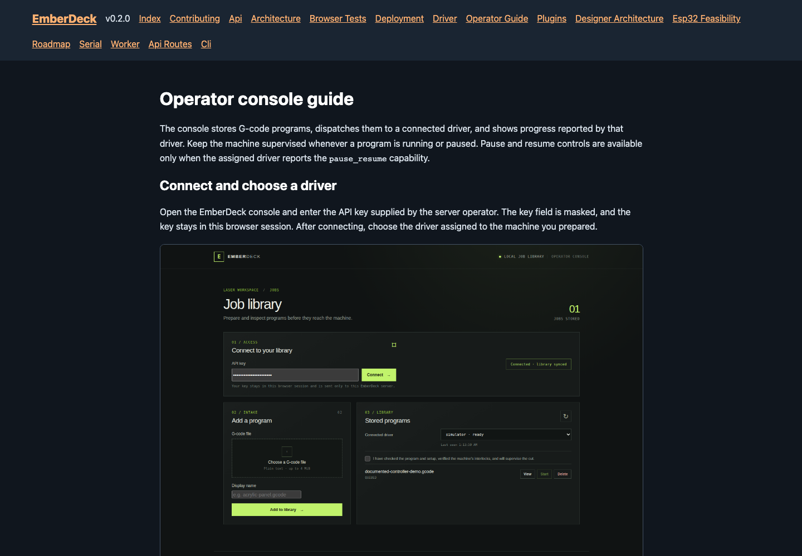
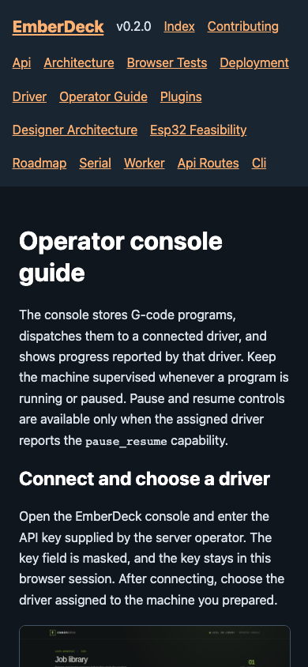
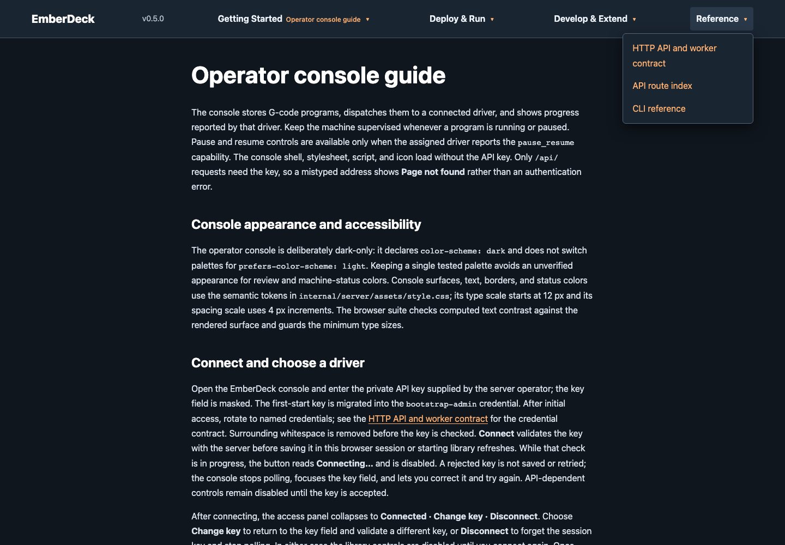
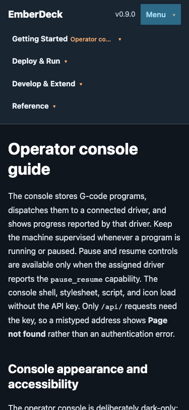

# Browser console tests

The Playwright suite runs the embedded console against a real EmberDeck HTTP
server with its GRBL simulator. It covers API key connection, G-code upload,
the safety confirmation gate, live progress, program viewing, completion,
controller acknowledged pause and resume, cancellation while paused, and deletion.
The pause test observes the simulator's `Hold:0` acknowledgement across repeated
job polls and confirms progress stays fixed while held. After the explicit
Resume, it verifies acknowledged progress advances and accepts either a sampled
`Run` report or a completed job with the final `Idle` report; a short simulator
job can finish between UI polls. It does not connect to or qualify physical
hardware.

The rectangle designer workflow creates a declared GRBL profile and a saved
vector-engrave rectangle project through the browser. It verifies invalid bounds
block save and generation, profile revision changes require project review, and
projects persist across page reload. Generation adds a queued job and opens its
program and provenance for review without starting it. It refuses generation
while edits are unsaved and clears an already checked readiness box when a new
program is generated. The test then checks the existing readiness gate,
dispatches explicitly to the simulator, and verifies the job completes. It also
checks narrow-screen overflow. The browser test uses the rendered UI and real
HTTP API rather than mocking storage.

## Run locally

Install the Python documentation dependency, pinned Node dependencies, and
Chromium, then run the suite:

```sh
python3 -m pip install -r docs/requirements.txt
npm ci
npx playwright install chromium
npm test
```

The test runner builds `bin/emberdeck` from current sources unless
`EMBERDECK_BINARY` supplies an explicit prebuilt binary. It starts
`emberdeck serve -simulate` with a temporary data directory and a test-only API
key, waits for the HTTP server, runs the Playwright tests, then stops the server
and removes the temporary data. No production data or API key is used.

The runner chooses an available local port automatically. Set
`EMBERDECK_E2E_PORT` to use a specific port. Set `EMBERDECK_BINARY` to use an
already-built binary at another path.

The CI workflow installs Chromium and its Linux dependencies, builds the CLI,
and runs `npm test`. On failure, it uploads Playwright screenshots, traces,
videos, and the HTML report as the `browser-test-failures` artifact.

## Documentation navigation review

The static site groups pages by what readers are trying to do:

- **Getting Started:** Index and Operator Guide.
- **Deploy & Run:** Deployment and Serial.
- **Develop & Extend:** Contributing, Architecture, Plugins, Browser Tests,
  Artifact Tests, Roadmap, Designer Architecture, and ESP32 Feasibility.
- **Reference:** API, generated API Routes, generated CLI, Driver, and Worker.

The Operator Guide is the first item in Getting Started. Four native disclosure
menus keep the top bar compact; the current page name remains visible in its
category summary, and the matching link carries `aria-current="page"`. A skip
link appears first in the keyboard order. At narrow widths, the menu summaries
stack into full-width rows; opening one expands its links below that row.
At wider widths, categories wrap across rows when their labels do not fit, which
keeps the nav usable with larger text settings.

`e2e/docs-navigation.spec.js` builds and opens the public rendered HTML. It
checks every generated page for one current link, all four complete groups,
working local page links and images, desktop/mobile overflow, keyboard access,
visible focus, and touch activation. The test also covers the generated API
Routes and CLI pages.

The before captures show the deployed v0.2.0 page. After captures show the
locally rendered page at the same desktop and mobile viewport sizes. Regenerate
the after captures with `npm run docs:screenshots`; the release build renders
the Markdown pages after screenshot regeneration.

**Before, desktop (1440 × 1000):** deployed guide with the flat navigation.



**Before, mobile (390 × 844):** deployed guide with wrapped navigation links.



**After, desktop (1440 × 1000):** local guide with grouped navigation and the current page visible.



**After, mobile (390 × 844):** local guide with the Getting Started menu open.


