# Operator console guide

The console stores G-code programs, dispatches them to a connected driver, and
shows progress reported by that driver. Keep the machine supervised whenever a
program is running or paused. Pause and resume controls are available only when
the assigned driver reports the `pause_resume` capability. The console shell,
stylesheet, script, and icon load without the API key. Only `/api/` requests
need the key, so a mistyped address shows **Page not found** rather than an
authentication error.

## Console appearance and accessibility

The operator console is deliberately dark-only: it declares `color-scheme: dark`
and does not switch palettes for `prefers-color-scheme: light`. Keeping a single
tested palette avoids an unverified appearance for review and machine-status
colors. Console surfaces, text, borders, and status colors use the semantic
tokens in `internal/server/assets/style.css`; its type scale starts at 12 px and
its spacing scale uses 4 px increments. The browser suite checks computed text
contrast against the rendered surface and guards the minimum type sizes.

Keyboard focus uses the same green outline on links and controls. Opening a
profile, project, or program view moves focus into it; closing it with its
button or Escape returns focus to the control that opened it. Escape asks
**Discard unsaved changes?** for a changed profile or project; cancel keeps the
editor open. When the operating system requests reduced motion, the console
uses immediate scrolling and removes the button hover lift.

## Connect and choose a driver

Open the EmberDeck console and enter the private API key supplied by the server
operator; the key field is masked. The first-start key is migrated into the
`bootstrap-admin` credential. After initial access, rotate to named credentials;
see the [HTTP API and worker contract](api.md) for the credential contract.
Surrounding whitespace is removed before the key is checked. **Connect**
validates the key with the server before saving it in this browser session or
starting library refreshes. While that check is in progress, the button reads
**Connecting…** and is disabled. A rejected key is not saved or retried; the
console stops polling, focuses the key field, and lets you correct it and try
again. API-dependent controls remain disabled until the key is accepted.

After connecting, the access panel collapses to **Connected · Change key ·
Disconnect**. Choose **Change key** to return to the key field and validate a
different key, or **Disconnect** to forget the session key and stop polling. In
either case the library controls are disabled until you connect again. Once
connected, choose the driver assigned to the machine you prepared.

## Prepare the machine

The **Manual controls** panel appears below the driver selector. Controls remain
disabled until the selected worker advertises the matching `manual_*`
capability, its controller state is safe for the action, and you check the
preparation confirmation. Each action opens a second confirmation dialog with
the driver and motion details. Home, jog, set-zero, and frame require the
controller to report **Idle**; unlock is available only for an **Alarm** state.
Jog is limited to 25 mm per move and 3000 mm/min. Frame is offered only for
jobs with known in-bounds geometry, and traces the reviewed rectangle with the
laser off. If homing times out or is interrupted, EmberDeck sends a GRBL soft
reset and waits for **Alarm**; the controller position is then considered lost
and the machine must be homed again before position-dependent work. Stay at the
machine and supervise. The panel cannot replace physical interlocks or an
emergency stop.

If a controller command may have been only partly written, jog cancel and feed
hold cannot clear GRBL's buffered line. EmberDeck soft-resets the controller and
requires its restart banner plus a terminal **Idle** or **Alarm** status. The
machine may need re-homing. If reset cannot be confirmed, EmberDeck records a
driver quarantine that survives server restarts and blocks jobs and manual
actions. The worker retries reset confirmation; if the controller is
unreachable, inspect or power-cycle it at the machine, then wait for the worker
to confirm the reset before releasing the lease or starting work. If recovery
leaves the controller in **Alarm** while a manual lease is interrupted, unlock
it through the controller's own interface, then wait for EmberDeck to report
**Idle** before releasing that lease.

A queued manual request reserves the driver separately from the job queue. If
worker support is unavailable, no action capability is advertised and the
controls remain disabled. Use **Release manual control** only after inspecting
the machine; a worker-owned move must stop and report before its lease clears.
The browser sends typed action parameters only and never includes job G-code in
a manual request.

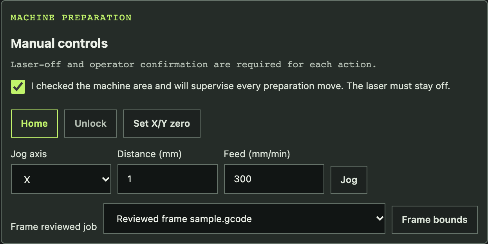

Action feedback appears in one dismissible notice: informational, warning, and
successful messages use a polite status announcement; errors use an alert.
Errors stay until dismissed or replaced, and successes remain for at least five
seconds. Profile/project counts are separate from action feedback, so refreshes
do not replace it.

Select a screenshot to open the full-size image.

## Open the designer

Choose **Designer** in the top navigation to open the dedicated design page.
Machine profiles, rectangle projects, and multi-path vector projects live on
that page. Choose **Job library** to return to G-code intake and stored
programs. Generating a design creates a separate queued job; inspect and
explicitly dispatch it from the job library.

On phones, page links move to a second row below the brand and driver selection
stacks below its label. The library uses a two-column layout on wide screens and
expands to 1600 px at viewport widths of 1600 px and above.

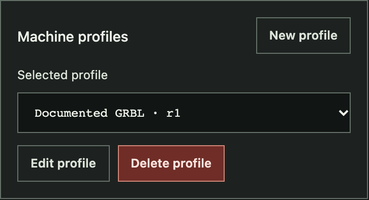

## Find the job library controls

The job library contains G-code intake and stored programs. The overview below
shows these controls independently from design sources.

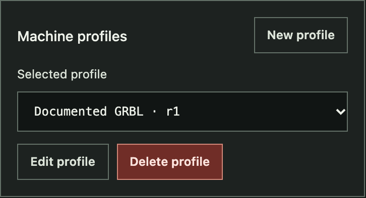

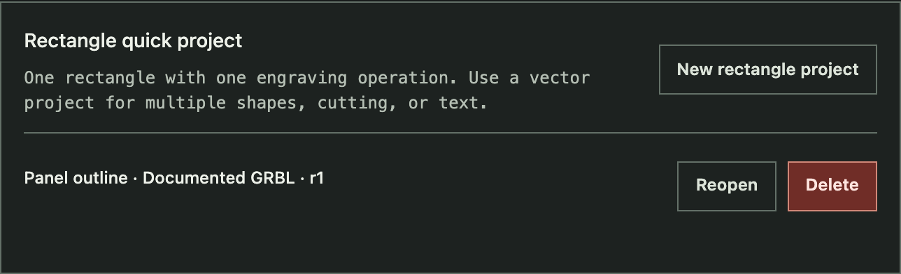

| Area | Controls | What they do |
| --- | --- | --- |
| Machine profiles | **New profile**, **Edit profile**, **Delete profile** | Store the declared GRBL work area and limits used by the rectangle editor. |
| Design projects | **New rectangle project** or **New vector project**, **Reopen**, **Save**, **Generate queued job**, **Delete** | Each saved project lists its machine profile and saved profile revision. **Needs review** marks projects whose profile has since changed or disappeared. Reopening selects the project's profile and announces a profile switch. Empty lists explain how to create a project. Edit a v1 rectangle engraving source or a v2 multi-path design with ordered engraving/cutting layers and editable monoline text engraving, preview its declared envelope, or create a separate queued program. |
| Add a program | File chooser, display name, profile selector, **Add to library** | Upload plain-text G-code (up to 4 MiB), validate line limits, and review its known path against the selected profile. |
| Stored programs | Driver selector, readiness checkbox, bounds override, **Name** and **State** filters, **View**, **Start**, **Pause**, **Resume**, **Cancel**, **Delete**, **← Newer** / **Older →** | Each job shows its creation time, byte size, and whether it was uploaded or generated. Empty lists explain how to add G-code. Find, inspect, and manage jobs through explicit bounds override, readiness confirmation, and Start and Cancel confirmation dialogs. Available controls depend on job state and driver capabilities. |

The profile and project lists remain separate from generated jobs: deleting a
source project does not delete a generated program, and editing a source does
not change an existing program.

While the library tab is visible, jobs and driver status refresh every two
seconds. Profile and project changes sync separately every 10 seconds. In a
hidden tab, job refresh backs off to at most once every 30 seconds and profile
and project sync to once every five minutes. Returning to the tab triggers a
fresh sync. Refreshes keep keyboard focus on the same row action when that row
still exists.

When another browser tab or operator saves the project you have open, EmberDeck
compares its saved revision during the regular sync and when you return to a
background tab. The editor shows who saved the newer revision and when. A clean
editor can reload it directly. If the form has unsaved edits, the editor keeps
them in place, disables saving over the newer revision, and offers **Reload
latest** (with a discard prompt) or **Continue as separate project**. The latter
keeps your local geometry and settings and changes the save target to a new
project; save it when ready. A save that races with another operator's update is
rejected with the same recovery choices. No changes are merged automatically.

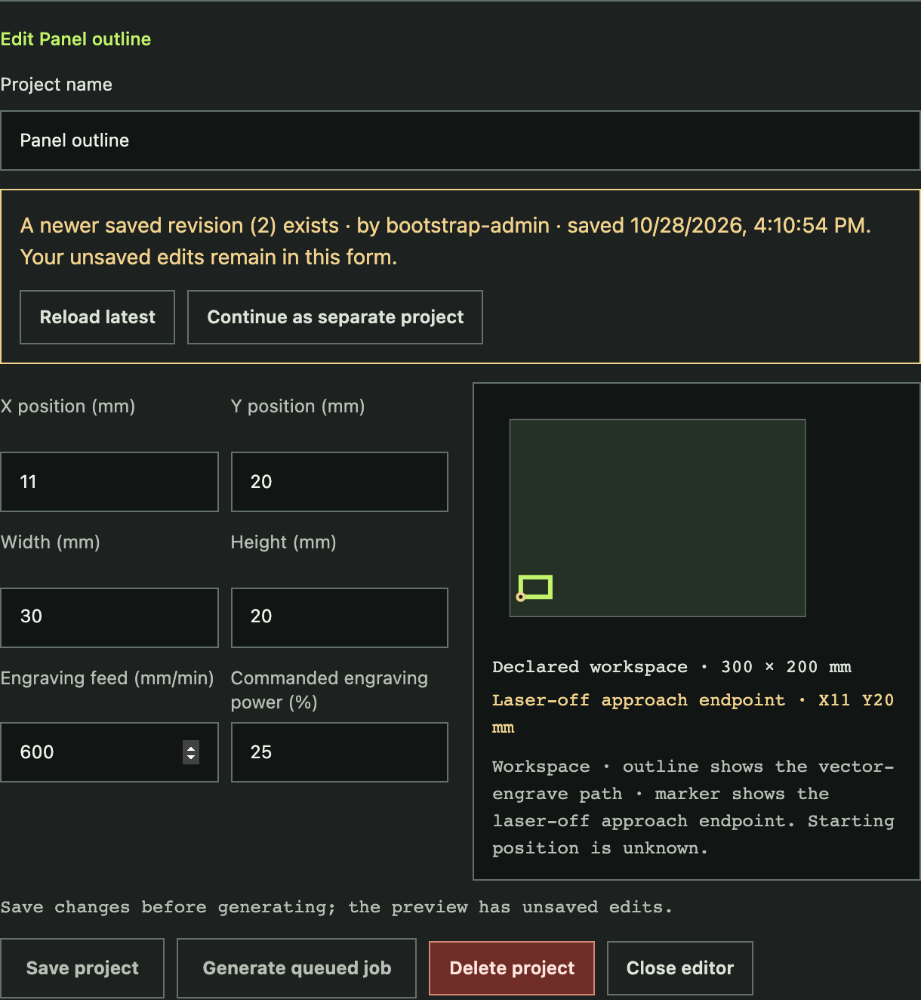

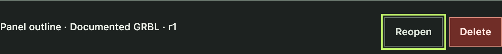

## Add and inspect a program

Choose a G-code file, enter a display name, select the declared machine profile,
and add it to the library. Upload rejects driver line-limit errors with their
source line before the job is queued. The job row shows known XY bounds and a
static path preview against the profile work area. Arcs, incremental positioning,
machine-coordinate moves, work-coordinate writes, homing (`G28`/`G30`), a first
move that could fire the laser from an unknown starting position, or a
stale/missing profile keep the overall bounds status **unknown**. A first move
made with the laser off only positions the head: the preview notes that its
travel from the current position is not drawn, and a program whose every other
point is known and inside the work area reviews as **in bounds**. Such a job
needs no bounds override; only the supervision check is required before
**Start**. The preview cannot establish the current head position or physical
machine safety.

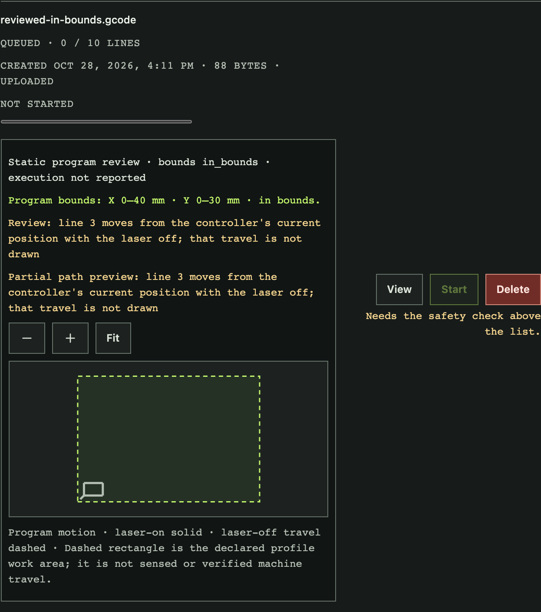

An **in bounds** review does not replace checking the program and machine. For
**out of bounds** or **unknown** jobs, inspect the warnings, path, and profile;
the per-job override checkbox must be selected before **Start** is enabled.
Then verify the machine's interlocks and check the supervision box. Both
confirmations are explicit and the bounds override is cleared after dispatch.

## Start a program

**Start** never dispatches on its own. Selecting it opens a confirmation that
names the job, the selected driver, the bounds review result, and the
generating profile when the job came from a design project. Focus starts on
**Go back**. Select **Start on _driver_** to send the program to that driver, or
**Go back** (or press Escape) to close the dialog without starting anything.
Focus then returns to the row's **Start** button. The driver shown in the
dialog is the one the request uses, even if the driver selector changes while
the dialog is open, and the server still refuses a driver that is not
connected or ready.

When **Start** is unavailable, it stays in the keyboard Tab order and reads as
dimmed. The reason appears beneath the row's buttons and is announced as the
button's description. Only one reason shows at a time, in this order:

| Reason | What to do |
| --- | --- |
| Needs a connected driver. | Start a driver worker or choose a connected driver. |
| Driver _name_ is busy with another job. | Wait for the active job to finish or cancel it. |
| Needs the bounds override above. | Inspect the review, then select the row's override checkbox. |
| Needs the safety check above the list. | Check the program, setup, and interlocks, then select the supervision checkbox. |

Selecting an unavailable **Start** does nothing. Every row button's accessible
name includes the job name, for example **Start panel.gcode** or
**Cancel panel.gcode**, so screen readers can tell the rows apart.

The library lists the newest programs first, 20 per page. The count beside the
console title shows how many programs match the current filters. Type part of a
name in **Name** or choose a **State** (Queued, Active, Completed, Failed or
interrupted, Canceled) to narrow the list. When more programs match than fit
on one page, use **Older →** and **← Newer** below the list; the range between
them shows which programs are on screen. Program text is loaded only when you
select **View**, so a large library stays quick to refresh.

The library shows when it was last updated. If a refresh fails, it labels the
displayed programs as stale and disables server-dependent actions such as
**View**, **Start**, and **Delete** until a refresh succeeds. The header dot
shows disconnected, connected, or error state; a recovered refresh clears the
connection error notice.

## Controller settings check

Each driver's worker reads the controller's settings with GRBL's read-only `$$`
command: once while idle when the server has none, and again before every job,
after the controller reports `Idle` and before the first program line.
EmberDeck never writes `$` settings. Below **Connected driver**, the console
shows the selected driver's last reading: `$30`/`$31` (spindle range), `$32`
(laser mode), `$20` (soft limits), and `$130`/`$131` (X/Y max travel), or why
the read failed.

A job generated from a profile can start only when the controller's `$30`,
`$31`, and `$32` match that job's profile snapshot. Each differing value is
listed on the job row, and **Start** is refused with the same field-by-field
message; the job stays queued. Change the controller with your usual GRBL tool,
or generate the job from a profile that matches. If the controller changes after
**Start**, the worker fails the job before sending program lines.

Uploaded programs are not blocked. Their row warns when the selected driver
reports `$32=0` (laser mode off) or the program uses `M3` (constant power). In
both cases the laser stays at its commanded power while motion stops, including
during a feed hold, so a pause does not turn it off. Soft limits and travel are
shown for reference only; profiles do not declare them. The **Start**
confirmation dialog repeats the driver's controller settings and any of these
warnings before you confirm.

## Declare a machine profile and design a rectangle

Connect with the server API key, then create a profile from the machine's
documented settings and declared work-area dimensions. This profile is an
operator declaration; EmberDeck does not home, zero, or write controller
settings. Set `$30` to the declared maximum spindle value, `$31=0`, and `$32=1`,
and prepare the lower-left origin of the active GRBL work coordinate system
before using the profile. **Start** refuses a generated job unless the selected
driver's controller reports the same `$30`, `$31`, and `$32` (see
[Controller settings check](#controller-settings-check)). Work coordinates are
not verified.
See the official [GRBL 1.1 settings reference at commit `bfb67f0`](https://github.com/gnea/grbl/blob/bfb67f0c7963fe3ce4aaf8a97f9009ea5a8db36e/doc/markdown/settings.md)
and [laser mode reference at the same commit](https://github.com/gnea/grbl/blob/bfb67f0c7963fe3ce4aaf8a97f9009ea5a8db36e/doc/markdown/laser_mode.md).
The commanded S percentage is not a measurement of optical output.

Create a rectangle project and enter its X/Y position, width, height, feed, and
commanded power percentage in millimetres. The SVG uses lower-left model
coordinates; its screen Y direction is only a view transform. It labels the
declared workspace, outline path, and laser-off approach endpoint. The actual
starting position is unknown, so the preview does not draw a travel path to the
endpoint. Geometry outside the declared envelope, invalid feed or power, and
values with more than three decimal places block saving and generation.
The version 1 rectangle editor supports one rectangle and vector engraving.
Version 2 supports multiple rectangle, ellipse, line, and monoline text objects,
described below.
The multi-path editor can import a bounded static SVG subset. It converts
physical dimensions and the viewBox to editable millimetre paths. Supported
`<text>` elements become open monoline strokes using the fixed
`emberdeck-stick-v1` font. SVG text needs a unitless `font-size` from 1 to 100
SVG user units and supports at most 32 ASCII characters: A–Z, a–z, digits,
space, and `. , : ; ! ? + - / _ ( )`. Lowercase letters use uppercase strokes.
Text may set unitless `x` and `y` and a transform. Only `x`, `y`, `font-family`,
`font-size`, `id`, and `transform` attributes are accepted on `<text>`. Other
fonts, `style` or other unsupported attributes, nested text elements such as
`<tspan>`, and raster images are rejected. Imported geometry remains
unassigned; no operation or machine settings are inferred.

An untouched new project says **Save the project to enable generation**. Once
you change its values, the editor shows an unsaved-edits hint. The hint clears
if you restore the saved values; a profile revision warning remains separate
until the project is reviewed and saved against that revision.

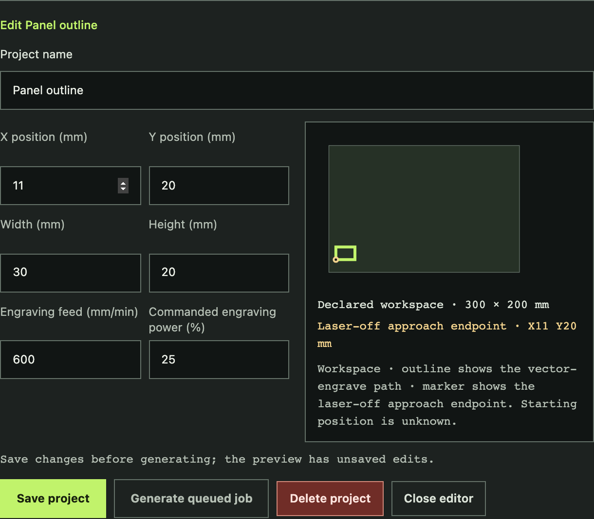

If a shape extends past the declared workspace, the editor explains the bounds
error and disables both saving and generation until the dimensions are corrected.
The preview keeps the full rectangle visible at its actual position and marks
the overrun with a warning outline. Workspace dimensions and the laser-off
approach coordinates appear as text below the drawing so they remain readable
at phone widths.

Saved profiles and projects can be reopened, edited, and deleted. Editing a
profile makes its projects require review against the new revision; save the
project against the selected revision before generating. Deleting a referenced
profile is blocked by the server.
Closing a changed profile or project, opening another saved project, or starting
a replacement project asks **Discard unsaved changes?** Choose **Cancel** to
keep editing or confirm to discard the draft. The same guard applies to
multi-path vector projects. Restoring the saved values removes the discard
prompt. An untouched new project still needs to be saved before it can generate.
While a profile editor is open, generation is disabled. Save or cancel those
profile edits first; after saving a changed profile, review and save the project
against its new revision before generating.

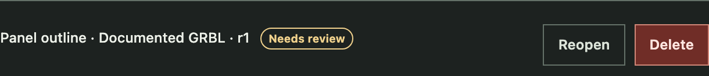

**Generate queued job** creates a normal library program. It does not dispatch
the job, and it clears any earlier supervision confirmation. Use **View** to
inspect its generated program and immutable project and profile provenance,
then review the machine setup and use the existing explicit supervision
confirmation and **Start** control when ready.

## Create a multi-path vector project

Select **New vector project** to add multiple rectangle, ellipse, and line
shapes. Click a path in the workspace to select it; drag the path to translate
it, or drag the corner handle to scale it in X and Y. The handle follows the
shape's transformed top-right corner, and resizing follows the shape's local
axes even when it is rotated. The object list also supports keyboard selection.
The numeric fields remain available for exact translation, nonuniform scaling,
and rotation around the source bounding-box center. The preview and profile bounds check use the
transformed geometry. Assign the shape to an
operation layer or remove it. Add engraving or cutting layers, set each
layer's feed and commanded power, and move layers to change execution order.
Every path must be assigned before generation. Lines can be engraved; cutting
requires closed shapes with nonzero area. The preview uses green for engraving,
red dashed outlines for cutting, and gray dotted paths for unassigned geometry.

Choose **Add text** to create a text object. Its source content, fixed font ID
`emberdeck-stick-v1`, height, and X/Y origin remain editable and are saved in
the project. The editor asks the server to generate the corresponding open
millimetre stroke paths; preview, profile bounds, and generated G-code use those
same paths. Text can only be assigned to vector engraving. Supported source
characters are ASCII A–Z and a–z, digits 0–9, space, and `. , : ; ! ? + - / _
( )`. Lowercase letters use uppercase stroke shapes. Text must contain 1–32
characters and be 1–100 mm high. Unsupported characters, empty/space-only text,
invalid size, and out-of-range coordinates show field errors and block save and
generation. The font is a small hand-authored stroke table with no external
runtime font dependency. This is vector engraving; raster engraving remains
unsupported. Static SVG `<text>` import supports only the fixed monoline font
and bounded character set described in the SVG importer section.

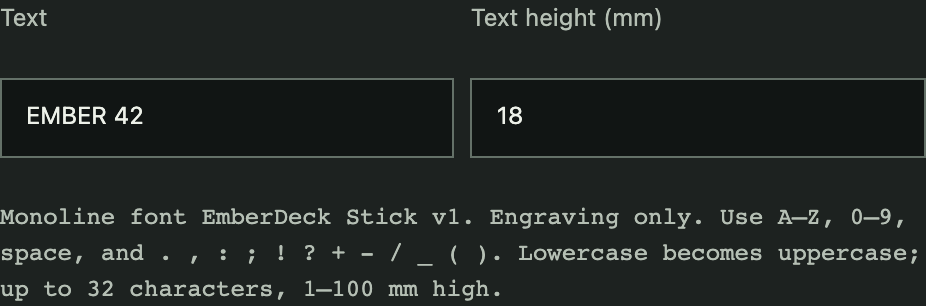

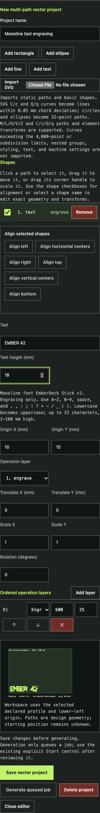

Use the shape checkboxes to select two or more shapes for alignment; the native
checkboxes work with the keyboard. Alignment controls stay disabled until at
least two shapes are selected. Left/center/right and top/middle/bottom alignment
use each path's transformed bounds, then update the per-shape translation. The
preview and profile bounds check update immediately, and any out-of-workspace
warning still blocks saving. Select a shape name to edit its geometry and
transform while keeping the group selection.

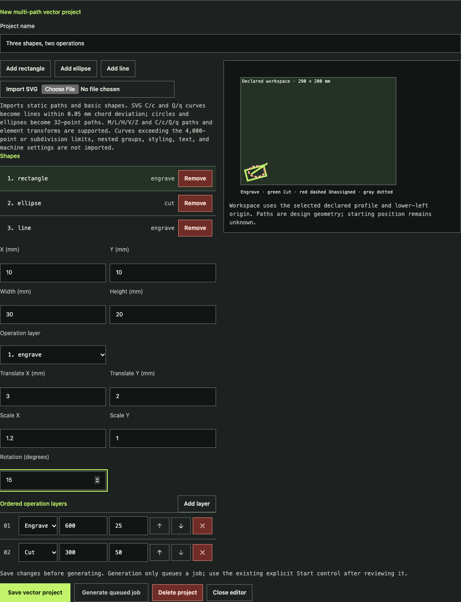

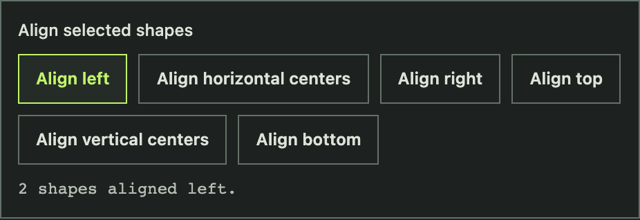

Choose **Import SVG** inside an open vector project to add static geometry. The
importer supports straight path commands (M/L/H/V/Z), cubic Bezier commands
(C/c/S/s), quadratic Bezier commands (Q/q/T/t), lines, polylines, polygons,
rectangles, circles, and ellipses. Smooth commands reflect the prior compatible
curve control point; otherwise they start from the current point. Curves become
line segments with at most 0.05 mm chord deviation after SVG and element
transforms. Nested `<g>` transforms compose with their parent and child element
transforms. Groups may contain only `id` and `transform` attributes and are
limited to 16 nested levels. Imports that exceed the 16-level curve-subdivision
or 4,000-point import limits are also rejected. Circle and ellipse outlines
become editable 32-point paths. Arc commands, group styling or other group
attributes, shape-level styling or other unsupported shape attributes,
external resources, and active content are rejected with an error. Only an
unqualified SVG or the official SVG namespace is accepted; foreign element
namespaces and namespaced attributes are rejected. Imported
geometry appears as editable, unassigned objects: no operation or machine
settings are imported. Inspect the preview and workspace bounds,
select each shape, and assign its engraving or cutting layer before generating.
Save and reopen the project through the same project controls.

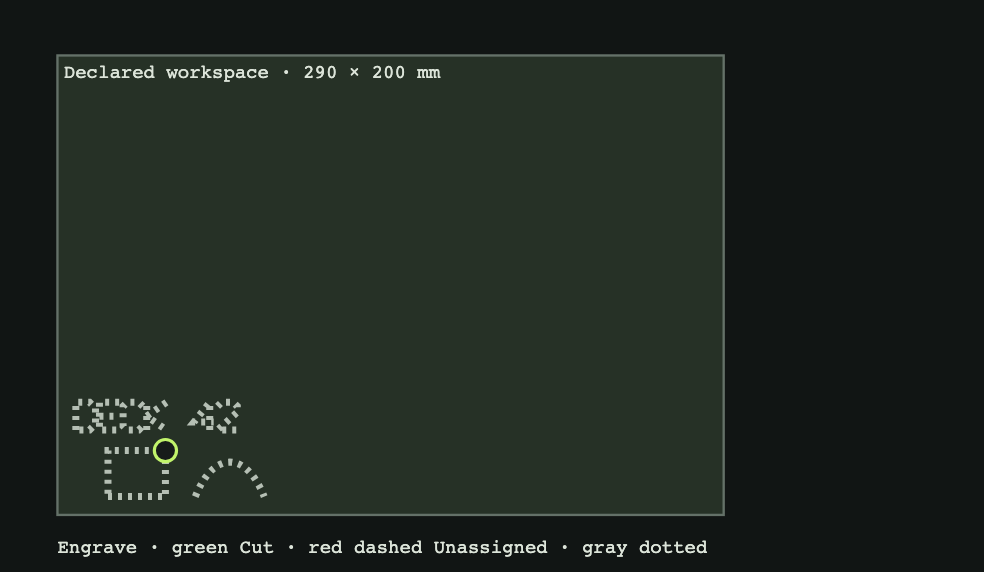

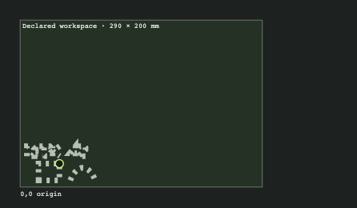

Generation creates an immutable queued G-code program with the project, profile,
and operation layer values in its provenance. Both cutting and engraving use
GRBL dynamic laser mode (`M4`), which turns output off when motion stops or is
held. This behavior and the declared machine profile still require verification
on the target controller and machine. Review the G-code and setup, then use the
existing readiness confirmation and **Start** control to dispatch.

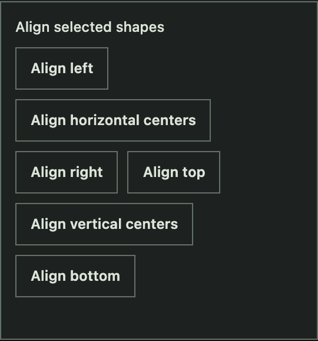

## Monitor a running program

The job row shows controller-acknowledged lines separately from the spatial
toolpath. Open **View** during a supported run to see completed, active, and
remaining XY segments, laser-off travel, and the latest available work position.
Use **+**, **−**, **Fit**, or drag the plot to inspect it. When a current profile
is available, the plot includes its declared work area as a dashed rectangle.
This is operator-declared profile data; it is not sensed or verified machine
travel. If the profile changed or was removed, the preview hides the rectangle
and reports that its work area is stale. An estimated head position assumes
GRBL reports millimetres (`$13=0`), and the UI labels that assumption. A
repeated or overlapping path can make correlation ambiguous;
missing coordinates, disconnects, pauses, and restarts can leave progress
unknown. If the server marks a job interrupted, its last reported work position
remains in the job record for context, but the plot hides the head marker because
it may be stale. Acknowledged lines are never treated as proof of completed
motion.

If an administrator configured a camera for the assigned driver, the job row
also shows a refreshed camera frame beside its progress and controls. A failed
or delayed source is labeled **Camera offline or stale**; an older frame stays
visible with its age. Camera frames are limited to one per second. A camera is
only an observation aid: it does not detect every hazard or replace continuous
operator supervision, an enclosure interlock, or an emergency stop.

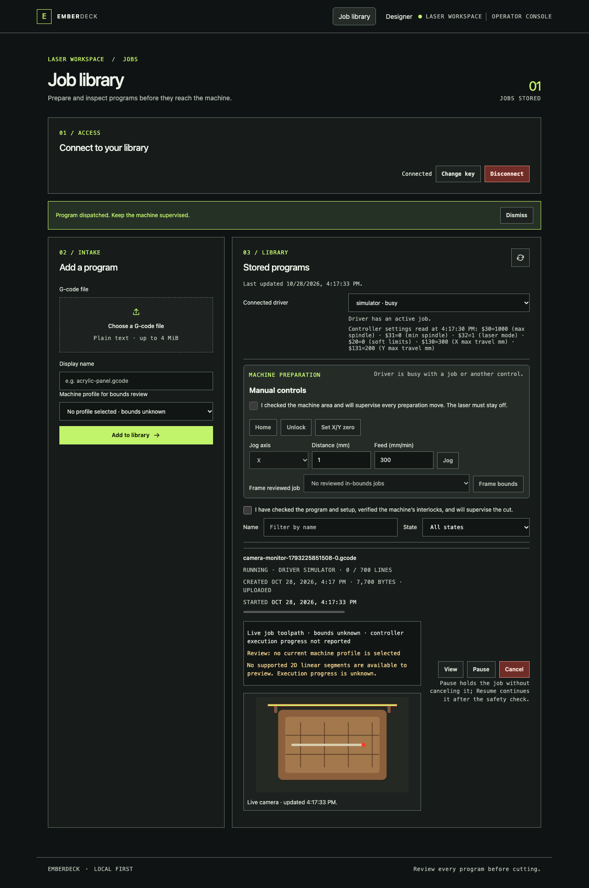

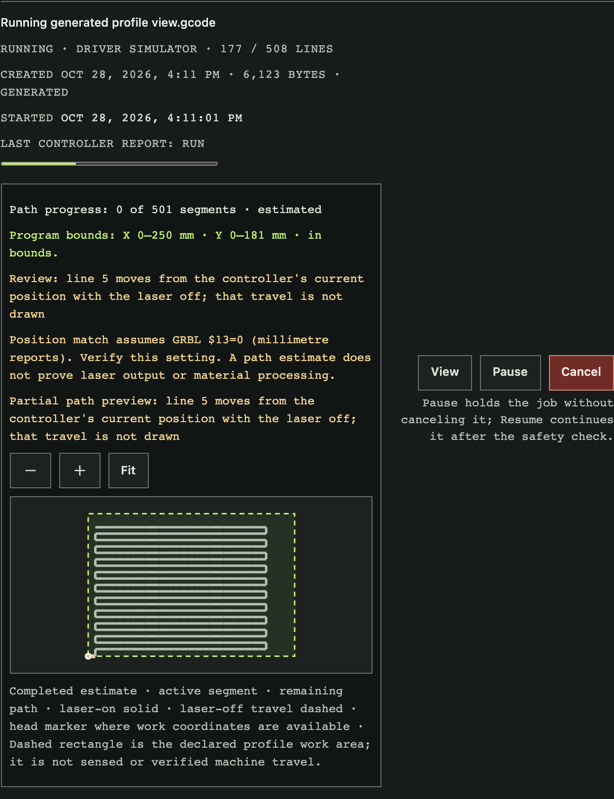

## Pause and resume

A held status reports motion, not laser output. Follow the controller's
[laser-mode requirements in GRBL's 1.1 laser mode documentation](https://github.com/gnea/grbl/blob/bfb67f0c7963fe3ce4aaf8a97f9009ea5a8db36e/doc/markdown/laser_mode.md)
and keep physical interlocks and emergency stops independent of software hold.

Select **Pause** while a capable assigned driver is running the program. Pause
is not confirmed so the hold request is sent immediately. It is reversible:
the job keeps its place and **Resume** continues it, and the row says so
beside the button. The console displays **Pausing…** while it waits for the driver and controller; that
status does not mean the machine is held. The row changes to **paused** only
after the controller reports a stable hold. The controller status is shown
separately as the last status received, for example `Hold:0`. It is a report
from the driver, not a live physical sensor.

To continue, check the safety confirmation again and select **Resume**. Until
the box is checked, **Resume** stays focusable but unavailable and shows
"Needs the safety check above the list to resume." The confirmation is cleared
after the request. The console shows the pending
`resuming` state until the driver reports that the controller is running again.

## Cancel and remove jobs

**Cancel** remains available while a job is running, pausing, paused, or
resuming. Selecting it opens a confirmation that names the job, its driver,
state, and acknowledged progress. **Cancel job** stops streaming and asks the
driver to halt the controller. A canceled job cannot be resumed or restarted.
**Keep running** (or **Keep paused**) and Escape close the dialog without
canceling and return focus to the row's **Cancel** button. Keep physical
emergency stops independent of this control. Active jobs cannot be deleted. Completed, failed, canceled, and
interrupted jobs can be removed with **Delete** after confirming the browser
prompt.

## Review job history

Each job row shows when the job started (was dispatched to a driver), when it
ended in a completed, failed, canceled, or interrupted state, and how long it
ran. A queued job shows **Not started**. Jobs stored before EmberDeck recorded
history have no start or end time.

**View** also opens the job's event history, oldest first. Each entry shows the
change (for example `queued → running`), when the server recorded it, and who
caused it:

- **operator**: upload, generation, Start, Pause, Resume, Cancel, or Delete
  requests made through the API or console, or revoking the credential of a
  worker that had an active job. The entry names the credential used.
- **worker**: a state reported by the assigned driver, such as a confirmed
  hold, completion, or failure, with the worker credential's name.
- **server**: an interruption recorded by the server itself after a restart or
  when the driver's heartbeat expired.

Entries for dispatched jobs name the driver and short session and lease
references. These are opaque digests for matching entries to each other and to
server logs; they are not the worker's credentials. Failure and interruption
entries include the reported reason. History stays available after a job is
deleted until retention removes it. The server keeps at most
`serve -job-event-limit` events (default 50,000) and drops events older than
`serve -job-event-retention` (default 90 days).

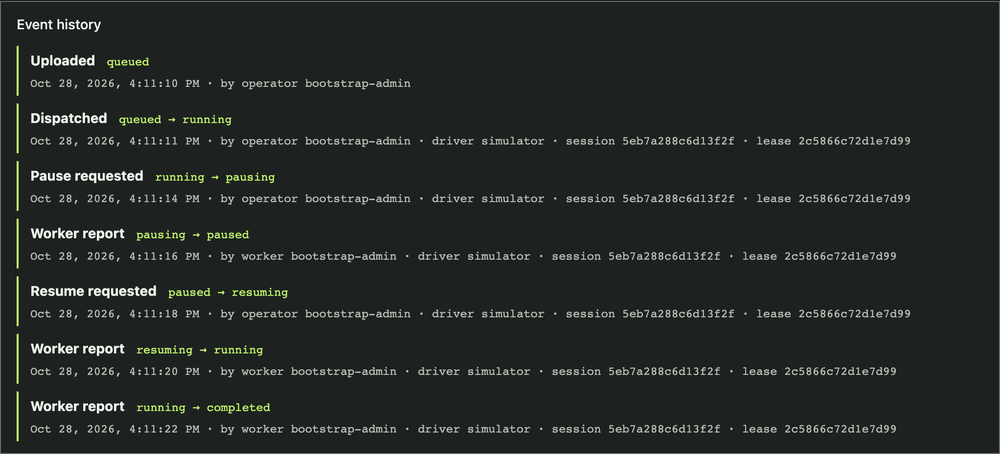

## Local browser walkthrough

The Playwright browser suite runs the console against an isolated local server
and GRBL simulator. It verifies controller acknowledgments and progress
behavior; the simulator does not qualify physical machine safety. See
[Browser console tests](browser-tests.md) for the command and scope.

Regenerate the screenshots from the current console and simulator with
`npm run docs:screenshots`.

## Requested UI that is not available yet

The current designer does not have undo/redo or raster engraving. Native
editable monoline text and bounded static SVG `<text>` import are supported as
described above.
SVG import supports straight paths, C/c/S/s cubic and Q/q/T/t quadratic Bezier
curves, and nested `<g>` groups up to 16 levels deep. Group transforms compose
with descendant group and element transforms. A/a arcs are not available. Live
path correlation currently covers supported linear XY moves; arcs and
unsupported coordinate modes are reported as warnings, and the view does not
show declared machine bounds. The console also has no driver-adapter
or importer-plugin configuration screens.
Existing plugins are trusted preflight
processes; they are not machine drivers or file converters. See the [designer
plan](research/designer-architecture.md),
[product status](roadmap.md), and the open requests for
[#4](https://github.com/ConstructorFleet/emberdeck/issues/4),
[#7](https://github.com/ConstructorFleet/emberdeck/issues/7),
[#15](https://github.com/ConstructorFleet/emberdeck/issues/15), and
[#16](https://github.com/ConstructorFleet/emberdeck/issues/16).
