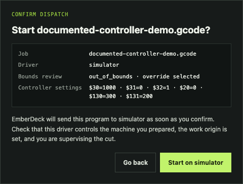
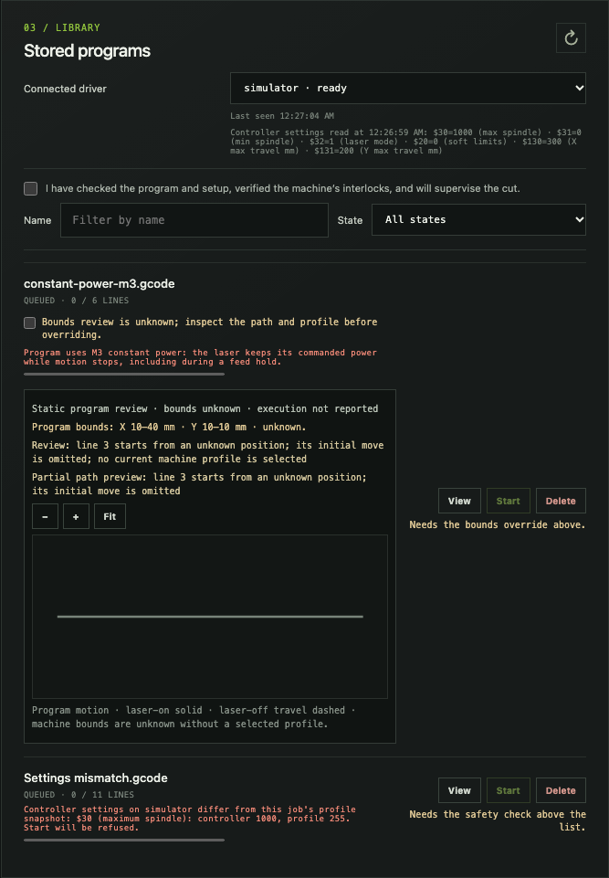
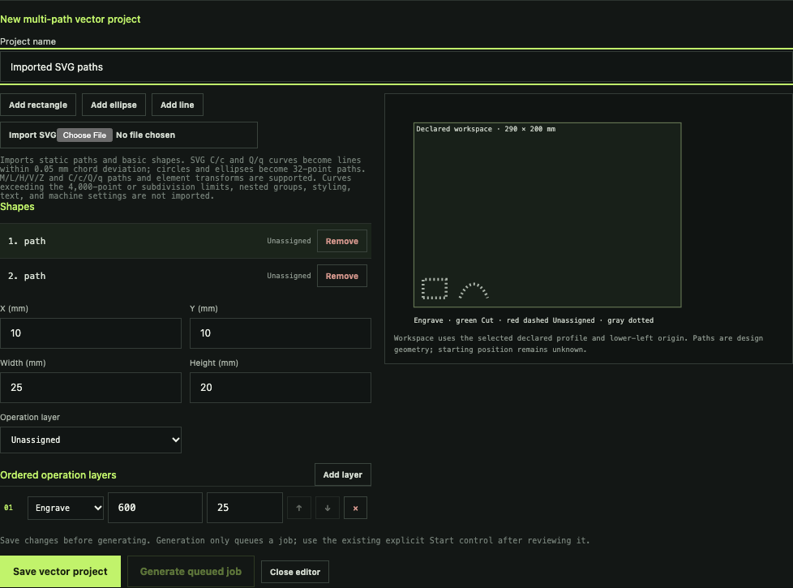
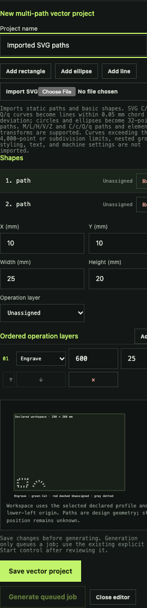
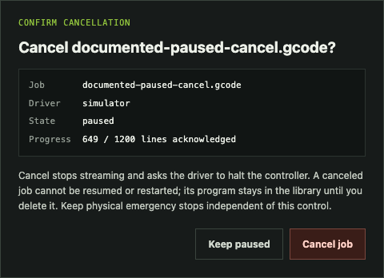

# Operator console guide

The console stores G-code programs, dispatches them to a connected driver, and
shows progress reported by that driver. Keep the machine supervised whenever a
program is running or paused. Pause and resume controls are available only when
the assigned driver reports the `pause_resume` capability. The console shell,
stylesheet, script, and icon load without the API key. Only `/api/` requests
need the key, so a mistyped address shows **Page not found** rather than an
authentication error.

## Connect and choose a driver

Open the EmberDeck console and enter the API key supplied by the server
operator; the key field is masked. Surrounding whitespace is removed before the
key is checked. **Connect**
validates the key with the server before saving it in this browser session or
starting library refreshes. While that check is in progress, the button reads
**Connecting…** and is disabled. A rejected key is not saved or retried; the
console stops polling, focuses the key field, and lets you correct it and try
again. API-dependent controls remain disabled until the key is accepted.

After connecting, the access panel collapses to **Connected · Change key ·
Disconnect**. Choose **Change key** to return to the key field and validate a
different key, or **Disconnect** to forget the session key and stop polling. In
either case the library controls are disabled until you connect again. Once
connected, choose the driver assigned to the machine you prepared.

## Find the main controls

The console groups design sources, G-code intake, and stored programs on one
page. The overview below shows a saved profile and project alongside the upload
and job controls. Close the project editor to return to the saved-project list;
select **Reopen** to continue editing.

| Area | Controls | What they do |
| --- | --- | --- |
| Machine profiles | **New profile**, **Edit profile**, **Delete profile** | Store the declared GRBL work area and limits used by the rectangle editor. |
| Design projects | **New rectangle project** or **New vector project**, **Reopen**, **Save**, **Generate queued job**, **Delete** | Edit a v1 rectangle engraving source or a v2 multi-path design with ordered engraving/cutting layers, preview its declared envelope, or create a separate queued program. |
| Add a program | File chooser, display name, profile selector, **Add to library** | Upload plain-text G-code (up to 4 MiB), validate line limits, and review its known path against the selected profile. |
| Stored programs | Driver selector, readiness checkbox, bounds override, **Name** and **State** filters, **View**, **Start**, **Pause**, **Resume**, **Cancel**, **Delete**, **← Newer** / **Older →** | Find, inspect, and manage jobs through explicit bounds override, readiness confirmation, and Start and Cancel confirmation dialogs. Available controls depend on job state and driver capabilities. |

The profile and project lists remain separate from generated jobs: deleting a
source project does not delete a generated program, and editing a source does
not change an existing program.

## Add and inspect a program

Choose a G-code file, enter a display name, select the declared machine profile,
and add it to the library. Upload rejects driver line-limit errors with their
source line before the job is queued. The job row shows known XY bounds and a
static path preview against the profile work area. Arcs, incremental positioning,
machine-coordinate moves, work-coordinate writes, an unknown starting position,
or a stale/missing profile keep the overall bounds status **unknown**. The
preview cannot establish the current head position or physical machine safety.

An **in bounds** review does not replace checking the program and machine. For
**out of bounds** or **unknown** jobs, inspect the warnings, path, and profile;
the per-job override checkbox must be selected before **Start** is enabled.
Then verify the machine's interlocks and check the supervision box. Both
confirmations are explicit and the bounds override is cleared after dispatch.

## Start a program

**Start** never dispatches on its own. Selecting it opens a confirmation that
names the job, the selected driver, the bounds review result, and the
generating profile when the job came from a design project. Focus starts on
**Go back**. Select **Start on _driver_** to send the program to that driver, or
**Go back** (or press Escape) to close the dialog without starting anything.
Focus then returns to the row's **Start** button. The driver shown in the
dialog is the one the request uses, even if the driver selector changes while
the dialog is open, and the server still refuses a driver that is not
connected or ready.

When **Start** is unavailable, it stays in the keyboard Tab order and reads as
dimmed. The reason appears beneath the row's buttons and is announced as the
button's description. Only one reason shows at a time, in this order:

| Reason | What to do |
| --- | --- |
| Needs a connected driver. | Start a driver worker or choose a connected driver. |
| Driver _name_ is busy with another job. | Wait for the active job to finish or cancel it. |
| Needs the bounds override above. | Inspect the review, then select the row's override checkbox. |
| Needs the safety check above the list. | Check the program, setup, and interlocks, then select the supervision checkbox. |

Selecting an unavailable **Start** does nothing. Every row button's accessible
name includes the job name, for example **Start panel.gcode** or
**Cancel panel.gcode**, so screen readers can tell the rows apart.

The library lists the newest programs first, 20 per page. The count beside the
console title shows how many programs match the current filters. Type part of a
name in **Name** or choose a **State** (Queued, Active, Completed, Failed or
interrupted, Canceled) to narrow the list. When more programs match than fit
on one page, use **Older →** and **← Newer** below the list; the range between
them shows which programs are on screen. Program text is loaded only when you
select **View**, so a large library stays quick to refresh.

## Controller settings check

Each driver's worker reads the controller's settings with GRBL's read-only `$$`
command: once while idle when the server has none, and again before every job,
after the controller reports `Idle` and before the first program line.
EmberDeck never writes `$` settings. Below **Connected driver**, the console
shows the selected driver's last reading: `$30`/`$31` (spindle range), `$32`
(laser mode), `$20` (soft limits), and `$130`/`$131` (X/Y max travel), or why
the read failed.

A job generated from a profile can start only when the controller's `$30`,
`$31`, and `$32` match that job's profile snapshot. Each differing value is
listed on the job row, and **Start** is refused with the same field-by-field
message; the job stays queued. Change the controller with your usual GRBL tool,
or generate the job from a profile that matches. If the controller changes after
**Start**, the worker fails the job before sending program lines.

Uploaded programs are not blocked. Their row warns when the selected driver
reports `$32=0` (laser mode off) or the program uses `M3` (constant power). In
both cases the laser stays at its commanded power while motion stops, including
during a feed hold, so a pause does not turn it off. Soft limits and travel are
shown for reference only; profiles do not declare them. The **Start**
confirmation dialog repeats the driver's controller settings and any of these
warnings before you confirm.

## Declare a machine profile and design a rectangle

Connect with the server API key, then create a profile from the machine's
documented settings and declared work-area dimensions. This profile is an
operator declaration; EmberDeck does not home, zero, or write controller
settings. Set `$30` to the declared maximum spindle value, `$31=0`, and `$32=1`,
and prepare the lower-left origin of the active GRBL work coordinate system
before using the profile. **Start** refuses a generated job unless the selected
driver's controller reports the same `$30`, `$31`, and `$32` (see
[Controller settings check](#controller-settings-check)). Work coordinates are
not verified.
See the official [GRBL settings reference](https://github.com/gnea/grbl/blob/master/doc/markdown/settings.md)
and [laser mode reference](https://github.com/gnea/grbl/blob/master/doc/markdown/laser_mode.md).
The commanded S percentage is not a measurement of optical output.

Create a rectangle project and enter its X/Y position, width, height, feed, and
commanded power percentage in millimetres. The SVG uses lower-left model
coordinates; its screen Y direction is only a view transform. It labels the
declared workspace, outline path, and laser-off approach endpoint. The actual
starting position is unknown, so the preview does not draw a travel path to the
endpoint. Geometry outside the declared envelope, invalid feed or power, and
values with more than three decimal places block saving and generation.
The version 1 rectangle editor supports one rectangle and vector engraving.
Version 2 supports multiple rectangle, ellipse, and line paths, described below.
The multi-path editor can import a bounded static SVG subset. It converts
physical dimensions and the viewBox to editable millimetre paths, but does not
import colors, styling, text, raster images, or machine settings.

If a shape extends past the declared workspace, the editor explains the bounds
error and disables both saving and generation until the dimensions are corrected.

Saved profiles and projects can be reopened, edited, and deleted. Editing a
profile makes its projects require review against the new revision; save the
project against the selected revision before generating. Deleting a referenced
profile is blocked by the server.
While a profile editor is open, generation is disabled. Save or cancel those
profile edits first; after saving a changed profile, review and save the project
against its new revision before generating.

**Generate queued job** creates a normal library program. It does not dispatch
the job, and it clears any earlier supervision confirmation. Use **View** to
inspect its generated program and immutable project and profile provenance,
then review the machine setup and use the existing explicit supervision
confirmation and **Start** control when ready.

## Create a multi-path vector project

Select **New vector project** to add multiple rectangle, ellipse, and line
shapes. Select a shape to edit its X/Y position and width/height, assign it to
an operation layer, or remove it. Add engraving or cutting layers, set each
layer's feed and commanded power, and move layers to change execution order.
Every path must be assigned before generation. Lines can be engraved; cutting
requires closed shapes with nonzero area. The preview uses green for engraving,
red dashed outlines for cutting, and gray dotted paths for unassigned geometry.

Choose **Import SVG** inside an open vector project to add static geometry. The
importer supports straight path commands (M/L/H/V/Z), cubic and quadratic
Bezier commands (C/c/Q/q), lines, polylines, polygons, rectangles, circles, and
ellipses. Curves become line segments with at most 0.05 mm chord deviation after
SVG and element transforms; imports that exceed the 16-level subdivision or
4,000-point import limits are rejected. Circle and ellipse outlines become
editable 32-point paths. Nested groups, smooth or arc commands, styles, text,
external resources, and active content are rejected with an error. Imported
shapes appear unassigned: inspect the preview and workspace bounds, select each
shape, and assign its engraving or cutting layer before generating. Save and reopen the
project through the same project controls.

Generation creates an immutable queued G-code program with the project, profile,
and operation layer values in its provenance. Both cutting and engraving use
GRBL dynamic laser mode (`M4`), which turns output off when motion stops or is
held. This behavior and the declared machine profile still require verification
on the target controller and machine. Review the G-code and setup, then use the
existing readiness confirmation and **Start** control to dispatch.

## Monitor a running program

The job row shows controller-acknowledged lines separately from the spatial
toolpath. Open **View** during a supported run to see completed, active, and
remaining XY segments, laser-off travel, and the latest available work position.
Use **+**, **−**, **Fit**, or drag the plot to inspect it. The plot fits the
program geometry; it does not know the physical machine bounds. An estimated
head position assumes GRBL reports millimetres (`$13=0`), and the UI labels that
assumption. A repeated or overlapping path can make correlation ambiguous;
missing coordinates, disconnects, pauses, and restarts can leave progress
unknown. Acknowledged lines are never treated as proof of completed motion.

## Pause and resume

A held status reports motion, not laser output. Follow the controller's
[laser-mode requirements](https://github.com/gnea/grbl/wiki/Grbl-v1.1-Laser-Mode)
and keep physical interlocks and emergency stops independent of software hold.

Select **Pause** while a capable assigned driver is running the program. Pause
is not confirmed so the hold request is sent immediately. It is reversible:
the job keeps its place and **Resume** continues it, and the row says so
beside the button. The console displays **Pausing…** while it waits for the driver and controller; that
status does not mean the machine is held. The row changes to **paused** only
after the controller reports a stable hold. The controller status is shown
separately as the last status received, for example `Hold:0`. It is a report
from the driver, not a live physical sensor.

To continue, check the safety confirmation again and select **Resume**. Until
the box is checked, **Resume** stays focusable but unavailable and shows
"Needs the safety check above the list to resume." The confirmation is cleared
after the request. The console shows the pending
`resuming` state until the driver reports that the controller is running again.

## Cancel and remove jobs

**Cancel** remains available while a job is running, pausing, paused, or
resuming. Selecting it opens a confirmation that names the job, its driver,
state, and acknowledged progress. **Cancel job** stops streaming and asks the
driver to halt the controller. A canceled job cannot be resumed or restarted.
**Keep running** (or **Keep paused**) and Escape close the dialog without
canceling and return focus to the row's **Cancel** button. Keep physical
emergency stops independent of this control. Active jobs cannot be deleted. Completed, failed, canceled, and
interrupted jobs can be removed with **Delete** after confirming the browser
prompt.

## Local browser walkthrough

The Playwright browser suite runs the console against an isolated local server
and GRBL simulator. It verifies controller acknowledgements and progress
behavior; the simulator does not qualify physical machine safety. See
[Browser console tests](browser-tests.md) for the command and scope.

Regenerate the screenshots from the current console and simulator with
`npm run docs:screenshots`.

## Requested UI that is not available yet

The current designer does not have multi-selection, rotation/alignment, text
import, undo/redo, or raster engraving. SVG import supports straight paths and
C/c/Q/q Bezier curves; nested groups, S/s/T/t smooth commands, and A/a arcs are
not available. Live path correlation currently covers supported linear XY
moves; arcs and unsupported coordinate modes are reported as warnings, and the
view does not show declared machine bounds. The console also has no driver-adapter
or importer-plugin configuration screens.
Existing plugins are trusted preflight
processes; they are not machine drivers or file converters. See the [designer
plan](research/designer-architecture.md),
[product status](roadmap.md), and the open requests for
[#4](https://github.com/ConstructorFleet/emberdeck/issues/4),
[#7](https://github.com/ConstructorFleet/emberdeck/issues/7),
[#15](https://github.com/ConstructorFleet/emberdeck/issues/15), and
[#16](https://github.com/ConstructorFleet/emberdeck/issues/16).
